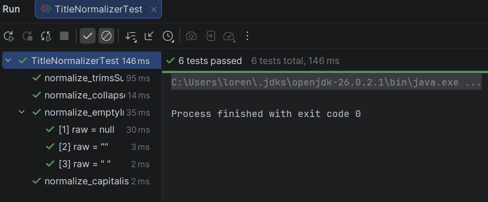
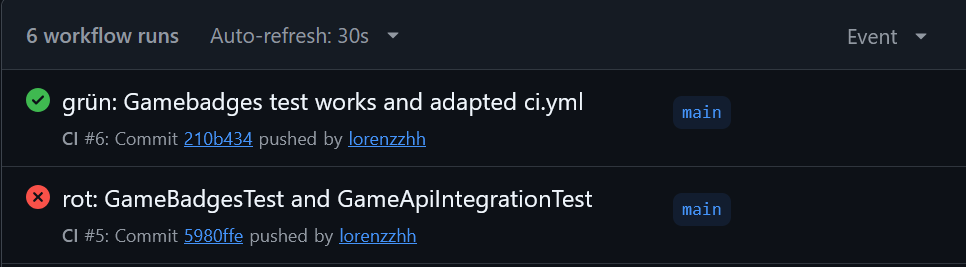

# Dokumentation

### Woche 1: TDD und CI/CD

TitleNormalizerTest Rot: Test Failing

TitleNormalizerTest Grün: Test Passing

### Woche 2: Integrationstest und Fehlerbericht

Zuerst Rote und dann Grüne Pipeline:

